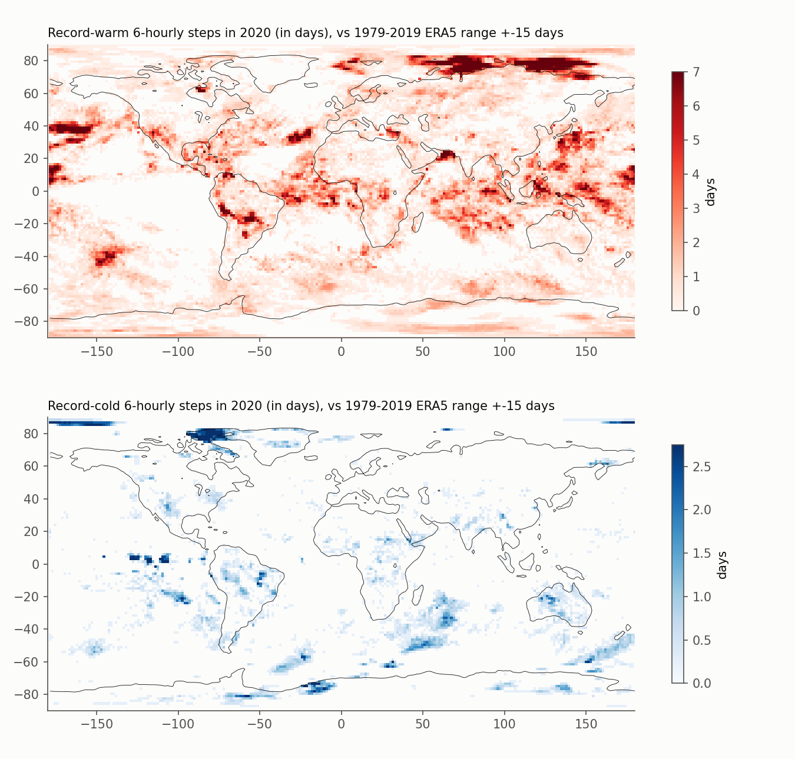
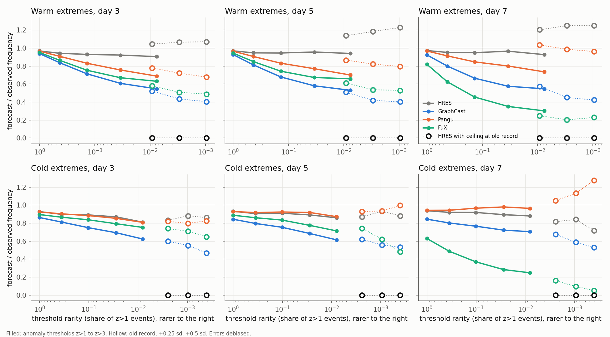
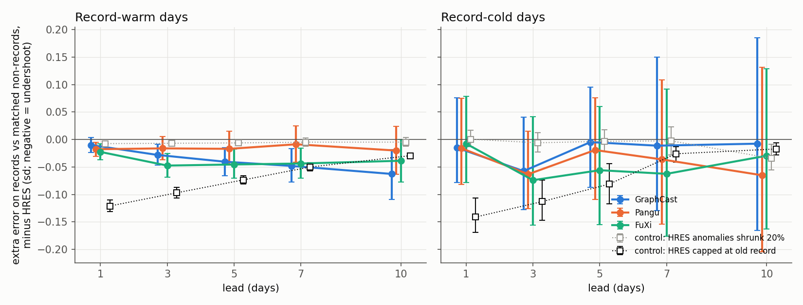
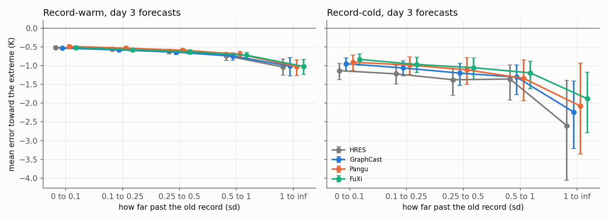
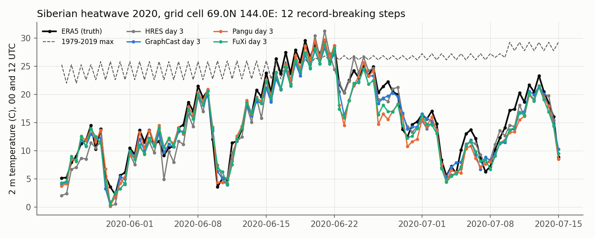
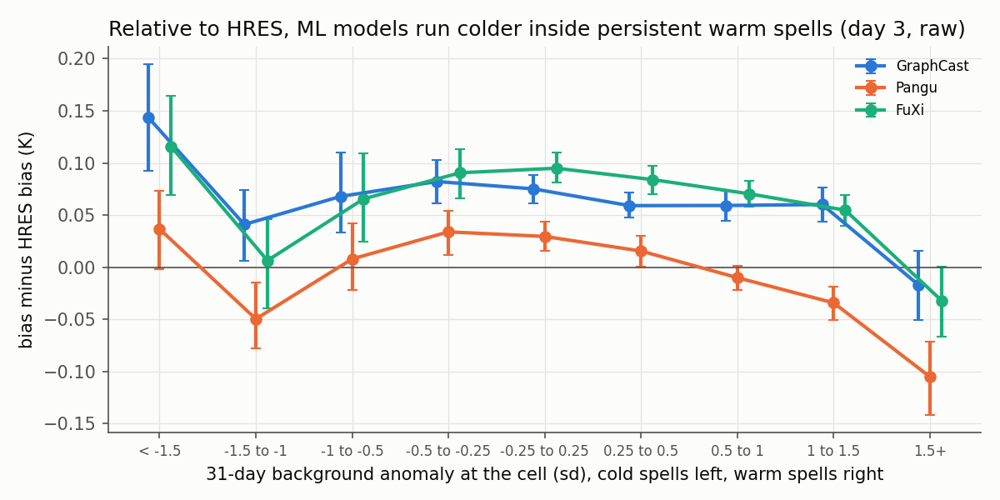

# Record Breakers: do AI weather models refuse to forecast temperatures they never saw?

ML weather models such as GraphCast, Pangu-Weather and FuXi learn only from past data (ERA5, 1979 to 2019 at the latest). A common worry is that they cannot go beyond the range of their training data, so they should fail on the days that matter most: new local records. This project tests that worry on every 2 m temperature record set in 2020, against ECMWF's physics model (HRES) as the reference.

**Short answer: no hard ceiling.** All three ML models undershoot extremes, but the undershoot grows smoothly with how rare a value is. It does not jump when the value passes the old record. They forecast record-breaking values about as often as they forecast equally rare non-record values, and their error does not grow with how far past the old record the truth went. A model with a real ceiling looks very different, and a synthetic control makes that difference visible. There is a small record-specific penalty, about 0.01 to 0.05 standard deviations, and a second small effect: in long, persistent warm spells the ML models run about 0.1 K colder (relative to HRES) than they do in ordinary weather.

## Data

| What | Source |
|---|---|
| Truth and climatology | ERA5 2 m temperature 1959 to 2020, 6-hourly, 1.5 degree grid (WeatherBench 2) |
| Forecasts | 2020 runs from 00 and 12 UTC, leads of 1, 3, 5, 7 and 10 days: HRES, GraphCast, Pangu-Weather, FuXi (WeatherBench 2, 1.5 degree conservative regrid) |
| Common sample | 702 initializations, 2020-01-01 to 2020-12-16 (FuXi archive ends there) |

All data are public at `gs://weatherbench2` and are read anonymously. NeuralGCM was dropped because its WeatherBench 2 archive has no 2 m temperature.

## Definitions

- **Record:** at a grid cell, the truth exceeds the highest ERA5 value from 1979 to 2019 at the same synoptic hour within +-15 calendar days. That window covers every year any of the three ML models trained on, so a 2020 record is outside every model's training range at that place and season. Cold records mirror this with the minimum.
- In 2020, 0.23% of area-time was record-warm and 0.022% record-cold (figure 1).
- **Anomaly z:** truth minus the 1979 to 2019 mean, divided by the standard deviation, using the same hour and +-15 day window.
- **Debiased** forecasts subtract each model's own mean error at that cell and hour, taken over days 8 to 30 either side of the valid date. The event week itself is excluded. This removes each model's ordinary local and seasonal bias, including HRES's known offset from ERA5. **Raw** forecasts skip this step. Both are reported.

## Three tests

1. **Frequency by rarity (figure 2).** For a ladder of thresholds (z > 1 up to z > 3, then old record, record + 0.25 sd, record + 0.5 sd), take how often the forecast exceeds the threshold and divide by how often the truth does. A model with a training ceiling would fall off a cliff at the record thresholds. Values beyond z > 3 are about as rare as records (both around 1% of z > 1 events), so the two can be compared directly.
2. **Matched comparison (figure 3).** Among extreme steps (z >= 1.5), compare the error on record steps with the error on non-record steps at the same anomaly (0.1-sd bins) and latitude band (30 degrees). This is the extra error that comes from being past the old record rather than from being extreme. Errors are in sd units, and each ML model's extra error is shown minus HRES's.
3. **Error by exceedance (figure 4).** On record steps only, plot error against how far past the old record the truth went.

Two synthetic forecasts, both built from HRES, calibrate what the tests can see:

- **Ceiling control:** HRES capped at the old record. This is what a hard training-range limit looks like.
- **Shrunk control:** every HRES anomaly multiplied by 0.8. This is plain smoothing with no knowledge of the record, so the record-specific test should not fire on it.

The shrunk control scores about zero (-0.007 sd at day 3), which shows the matched test is not fooled by smoothing. An earlier version matched in kelvin with coarser bins and was fooled, so the test now matches in sd units with 0.1-sd bins.

Confidence intervals come from a bootstrap that resamples whole weeks of valid time (2,000 draws), which keeps heatwaves and their spatial footprint intact.

## Results



Warm records in 2020 clustered in the Siberian Arctic and the Kara and Laptev Seas, the subtropical North Pacific, the tropical Atlantic, South America and the Maritime Continent. Cold records were rare and scattered.

### 1. No cliff at the old record



Forecast frequency divided by observed frequency, debiased. Filled markers are anomaly thresholds and hollow markers are record thresholds.

| Warm side, debiased | z > 3 | old record | record + 0.5 sd |
|---|---|---|---|
| HRES, day 3 | 0.91 | 1.04 | 1.07 |
| GraphCast, day 3 | 0.55 | 0.52 | 0.40 |
| Pangu, day 3 | 0.69 | 0.78 | 0.68 |
| FuXi, day 3 | 0.63 | 0.58 | 0.49 |
| Ceiling control, day 3 | 0.70 | **0.00** | **0.00** |

The ML models forecast too few extremes, already at z > 2 and well inside the training range. Their ratios at the record thresholds sit on the continuation of the same downward curve. GraphCast forecasts record-breaking values about half as often as they occur, FuXi a bit more often and Pangu about three-quarters as often. A ceiling would give zero. At day 1 all three models catch about the same share of record-warm steps as HRES (hit rates 0.47 to 0.48 against 0.48). At day 3 the shares are 0.30 to 0.36 against 0.38.

### 2. A small record-specific penalty



Extra error on record steps compared with same-anomaly non-record steps, minus HRES, in sd units with 95% CI (warm side, debiased):

| lead | GraphCast | Pangu | FuXi | shrunk control | ceiling control |
|---|---|---|---|---|---|
| day 1 | -0.010 [-0.023, +0.003] | -0.018 [-0.031, -0.005] | -0.023 [-0.037, -0.008] | -0.008 | -0.121 |
| day 3 | -0.028 [-0.047, -0.009] | -0.016 [-0.037, +0.005] | -0.047 [-0.069, -0.025] | -0.007 | -0.097 |
| day 5 | -0.040 [-0.066, -0.015] | -0.017 [-0.046, +0.015] | -0.045 [-0.070, -0.018] | -0.006 | -0.074 |

GraphCast and FuXi show a real but small extra undershoot on records. At day 1 it is 8 to 19% of what a hard ceiling would produce, and at day 3 it is 17 to 49%. Pangu's is not distinguishable from zero after day 1.

At days 7 and 10 the ceiling control itself shrinks, because HRES rarely forecasts past the record at those leads anyway, so the test loses power there.

Cold records are too rare in a single year for firm conclusions: every ML confidence interval includes zero.

The result holds when "record" is defined over 1979 to 2017 (the Pangu and FuXi training span) or 1959 to 2019. At day 3 these give GraphCast -0.024 / -0.020, Pangu -0.013 / -0.013 and FuXi -0.043 / -0.041 sd ([tables/summary.md](tables/summary.md)).

### 3. Going further past the record does not make ML errors worse



At day 3 on warm records, the ML models' mean error tracks HRES almost exactly, from just past the old record to more than 1 sd past it. If the models were clamped to their training range, the error would grow by roughly 1 K for each 1 K the truth went past the record.

### Case: Siberia, June 2020



This is the Siberian land cell with the most record-breaking 00 and 12 UTC steps in the window (69.0N 144.0E). Day-3 forecasts from all three ML models went past the old record during the 18 to 22 June peak, slightly below HRES at the very top. Forecasts exist only at 00 and 12 UTC, so the truth is shown at those hours too.

### The raw numbers, and where they come from

Without debiasing, the matched test gives a larger ML penalty on warm records: -0.07 to -0.13 sd for all three models at days 1 to 10. That is as large as the ceiling control at days 3 and beyond. The difference comes from the weeks around the record, not from the record itself:



Binning raw bias by the 31-day background anomaly at the cell gives a clear pattern. In the most persistent warm spells (background above +1.5 sd, 1.4% of area-time), the ML models run 0.09 to 0.13 K colder, relative to HRES, than they do in ordinary weather (background within +-0.25 sd). In the most persistent cold spells (below -1.5 sd) GraphCast runs about 0.07 K warmer than usual; FuXi and Pangu show no clear shift there. Records cluster inside those long warm spells, so raw scores mix this slow drift with any record effect. The debiased test removes it by design.

Which number to quote depends on the question:

- **Can ML models forecast a value they never saw?** Use the debiased test. The answer is yes, nearly as well as HRES.
- **Do ML models struggle in a climate regime that keeps running warmer than their training data?** Use the raw test and figure 6. The answer is a little, about a tenth of a kelvin at days 3 to 5.

## Caveats

- **One year and one variable.** 2020 has many warm records but few cold ones. Cold-side conclusions are weak.
- **Gridded records on a 1.5 degree grid.** These are not station records. Conservative regridding smooths peaks for every model equally.
- **Only 00 and 12 UTC valid times** are forecast in the archive. In many longitudes these miss the afternoon maximum, so heat records are under-sampled at the hours that matter most for people.
- **ERA5 is the truth for every model**, which favours the ML models, since they were trained on ERA5. Debiasing removes most of HRES's mean offset, but not any difference in how sharply HRES and ERA5 resolve peaks.
- **Training years differ.** GraphCast's 2020 version saw 1979 to 2019; Pangu saw 1979 to 2017 for training and 2019 for validation; FuXi's paper describes 39 years of ERA5. The primary record period (1979 to 2019) is beyond all of them, and the 1979 to 2017 sensitivity check gives the same picture.
- **Deterministic models only.** Ensembles (GenCast and the IFS ensemble) are a natural extension; WeatherBench 2 has both for 2020.

## Reproduce

```bash
pip install -r requirements.txt
python fetch_era5.py        # ~10 min, streams 11 GB, writes 1.9 GB
python fetch_forecasts.py   # ~5 min, 4 x 400 MB
python analysis.py          # ~10 min, weekly sufficient statistics
python stats.py             # bootstrap tables
python regime.py            # background-anomaly bias
python figures.py
python report.py            # tables/summary.md
python -m pytest -q tests
```

| File | Role |
|---|---|
| `config.py` | sources, models, leads, record periods |
| `clim.py` | calendar indexing, windowed max/min/mean/sd |
| `analysis.py` | records, thresholds, matched strata, controls, debiasing |
| `stats.py` | point estimates and week-block bootstrap |
| `regime.py` | bias against 31-day background anomaly |
| `tables/` | `freq.csv`, `matched.csv`, `exceedance.csv`, `regime.csv`, `summary.md` |
